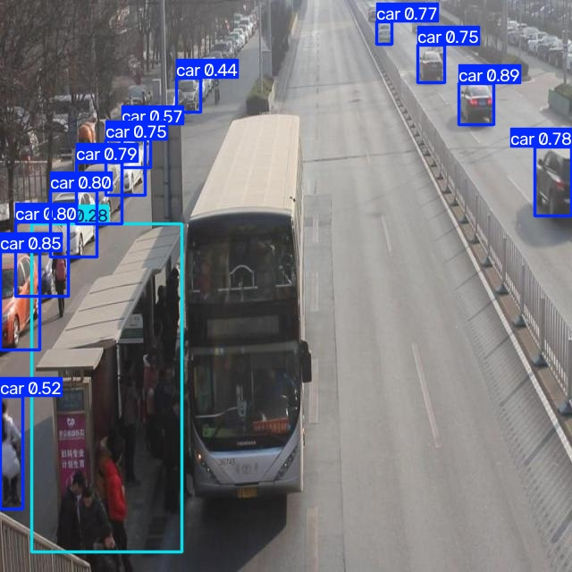

# Báo cáo cá nhân — Ngày 2 Object Detection

Đổi tên file theo `MSSV_HoTen.md`, ví dụ `20241234_NguyenVanAn.md`. Điền kết quả thật, xóa dòng hướng dẫn khi nộp. Xem [quy định nộp](../../SUBMISSION.md).

## 1. Thông tin học viên

- Họ tên: Lê Tuấn Khôi
- MSSV: 2A202603024
- Email: tuankhoi000@gmail.com
- Lớp: L2A
- Link repo bài làm: https://github.com/rifujin123/K5-L2-DAY02-LeTuanKhoi-2A202603024-ObjectDetection
- Link Colab đã chạy: Không chạy Colab; notebook được chạy cục bộ trong VS Code.

## 2. Schema và mini guideline

Dẫn tới [GUIDELINE_MINI.md](../../GUIDELINE_MINI.md).
Tôi dùng schema bốn lớp: `car` gồm xe con, SUV, taxi và xe bán tải; `truck` gồm xe tải chở hàng và xe đầu kéo; `bus` gồm xe buýt và minibus chở khách; `van` gồm xe van và minivan chở người hoặc hàng hóa.

Tôi vẽ một box riêng cho mỗi xe, bám theo phần thân nhìn thấy được. Với xe bị che khuất hoặc cắt khỏi khung hình, tôi chỉ dựa vào phần nằm trong ảnh và không ước lượng phần bị khuất. Nếu xe quá nhỏ hoặc hình ảnh không đủ rõ để nhận diện lớp, tôi ghi lại trường hợp đó để hỏi lab coach. Tôi không gán người đi bộ, xe đạp, xe máy, biển báo, đèn giao thông, hình xe quảng cáo hoặc xe chỉ xuất hiện trong phản chiếu.

Ba trường hợp tôi ghi lại trong mini guideline:

- `drive_002`: Nhiều xe ở xa và sát nhau; tôi không tự tin xác định lớp nên quyết định không gán nhãn.
- `drive_006`: Nhiều xe di chuyển từ nhiều hướng và sát nhau; tôi không tự tin nhận diện riêng từng xe nên quyết định không gán nhãn.
- `drive_039`: Ảnh ban đêm và ngược sáng khiến tôi không xác định chắc lớp xe nên quyết định không gán nhãn.

Tôi muốn lab coach làm rõ cách xử lý xe rất xa, nhỏ hoặc bị tối/ngược sáng: nếu hình dáng khiến tôi đoán khoảng 70–80% đó là `car`, tôi nên gán nhãn `car` hay bỏ qua? Tôi cũng muốn biết cần dựa vào dấu hiệu nào để quyết định nhất quán trong các trường hợp tương tự.

## 3. Annotation và self-QC

- Số file nhãn train: 50.
- Kết quả checker và lỗi đã xử lý: Đạt 50/50 file, cấu trúc hợp lệ.
- Danh sách ít nhất 10 ảnh đã rà bằng mắt: drive_002,drive_003,drive_005,drive_011,drive_012,drive_016,drive_018,drive_026,drive_027,drive_029.
- Lỗi bỏ sót/box/class phát hiện khi rà và cách sửa: Thiếu box cho một số xe chỉ nhìn thấy một phần nhưng vẫn nhận diện được; đã thêm box quanh phần nhìn thấy.
- Commit thêm nhãn train: `2aea34d` (`Add vehicle training annotations`). Commit khóa nhãn trước khi nhận gold: chưa có.

## 4. Gold QC và rework

| Chỉ số | Trước sửa | Sau sửa nếu có |
|---|---:|---:|
| TP | 455 | |
| FP | 468 | |
| FN | 198 | |
| Precision | 0.493 | |
| Recall | 0.6968 | |
| F1 | 0.5774 | |
| mean_iou_of_matches | 0.8563 | |
| passed | true (ngưỡng F1 0.50, mean IoU 0.70) | |

Dẫn tới [outputs/annotation_evaluation.json](../../outputs/annotation_evaluation.json). Kết quả hiện có là lần đánh giá trước rework; các cột “Sau sửa” để trống vì chưa có kết quả sau sửa được ghi nhận.

## 5. Kết quả YOLO

- Runtime, GPU/CPU, phiên bản Ultralytics và Torch: VS Code cục bộ; Python 3.14.5; CPU Intel Core i5-10300H 2.50 GHz; Ultralytics 8.4.208; PyTorch 2.15.0+cpu. GPU không được sử dụng (`GPU_mem=0G`).
- Các tham số thay đổi so với notebook nếu có và lý do: Cấu hình notebook là 50 epochs, `imgsz=640`, `batch=-1`. [Xác nhận nếu có thay đổi tham số.]
- Đường dẫn best checkpoint trong phiên chạy: `runs/detect/Day2-Lab/outputs/yolo26_runs/vehicle_annotation/weights/best.pt`.

| Chỉ số trên 10 ảnh eval | Giá trị |
|---|---:|
| Precision | 0.3336 |
| Recall | 0.3059 |
| mAP50 | 0.3044 |
| mAP50–95 | 0.2150 |

Ảnh minh họa:  — bus bị bỏ sót model nhầm với bus station.

Trả lời bốn câu hỏi cuối notebook:

1. Lớp recall thấp nhất là `bus` (recall 0.0; có 2 instance trong eval). Ảnh minh họa: .
2. Nếu mAP50 cao nhưng mAP50–95 thấp, cần kiểm tra box có quá rộng, lệch cạnh hoặc cắt mất phần xe nhìn thấy không; đồng thời xem prediction để phân biệt lỗi box với bỏ sót hoặc sai lớp.
3. Chưa kết luận lỗi phân lớp nào liên quan guideline chỉ từ các chỉ số tổng hợp. Cần xem confusion matrix và ảnh prediction, rồi ghi một ví dụ cụ thể đã xác nhận.
4. Không dùng 10 ảnh eval để cập nhật model nhằm giữ chúng ngoài tập train. Notebook dùng chúng làm validation để theo dõi và chọn checkpoint tốt nhất; vì vậy đây không phải tập test độc lập.

## 6. Khó khăn và cách xử lý

| Bước/thời điểm | Lỗi quan sát | Cách đã thử | Kết quả/còn thiếu |
|---|---|---|---|
| Chạy notebook cục bộ | `ModuleNotFoundError: No module named 'yaml'` | Cài `PyYAML` trong kernel rồi khởi động lại kernel | Notebook chạy tiếp được. |
| Train model | PyTorch là bản CPU (`2.15.0+cpu`); log báo `GPU_mem=0G` | Tiếp tục train trên CPU | Train và đánh giá hoàn tất; thời gian chạy chậm hơn GPU. |

## 7. Tự đánh giá theo rubric

Đối chiếu [RUBRIC.md](../../RUBRIC.md): đã có 50 nhãn train, checker đạt 50/50, gold QC `passed=true` theo ngưỡng F1 0.50 và mean IoU 0.70, đã chạy train/evaluate trên 10 ảnh eval và đã thêm hai thư mục assets. Còn thiếu: tên ảnh minh họa cho lớp recall thấp nhất, ví dụ lỗi phân lớp đã kiểm tra bằng confusion matrix/prediction, và xác nhận tham số có thay đổi hay không. Cần rà lại `GUIDELINE_MINI.md`: ví dụ ở dòng `car` và `truck` đang ghi van/minivan, chưa khớp schema; ngưỡng “100%” cũng chưa được quy định trong hướng dẫn lab.

## 8. Công cụ AI và tài liệu tham khảo

ChatGPT được dùng để giải thích quy tắc annotation và các chỉ số YOLO, hỗ trợ xử lý lỗi thiếu `yaml`, và góp ý cách diễn đạt báo cáo. Trong phiên hỗ trợ, ChatGPT cũng chạy checker và một lần evaluator với ngưỡng F1 cũ 0.80; file JSON hiện tại ghi ngưỡng F1 0.50. Tôi tự gán nhãn và chạy notebook train/evaluate trong VS Code. [Bổ sung phần tự kiểm tra thực tế nếu cần.]

Nguồn ngoài: [Ultralytics — YOLO performance metrics](https://docs.ultralytics.com/guides/yolo-performance-metrics/), [Ultralytics — Validation](https://docs.ultralytics.com/modes/val/).
